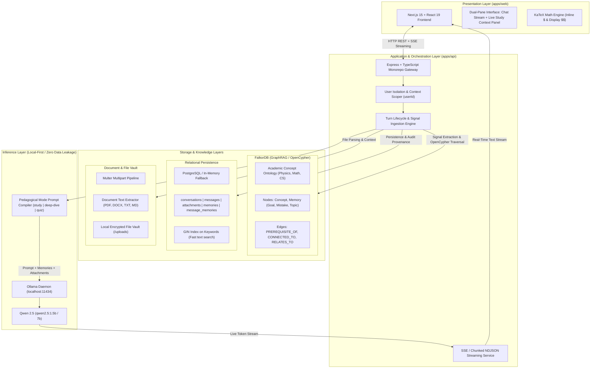
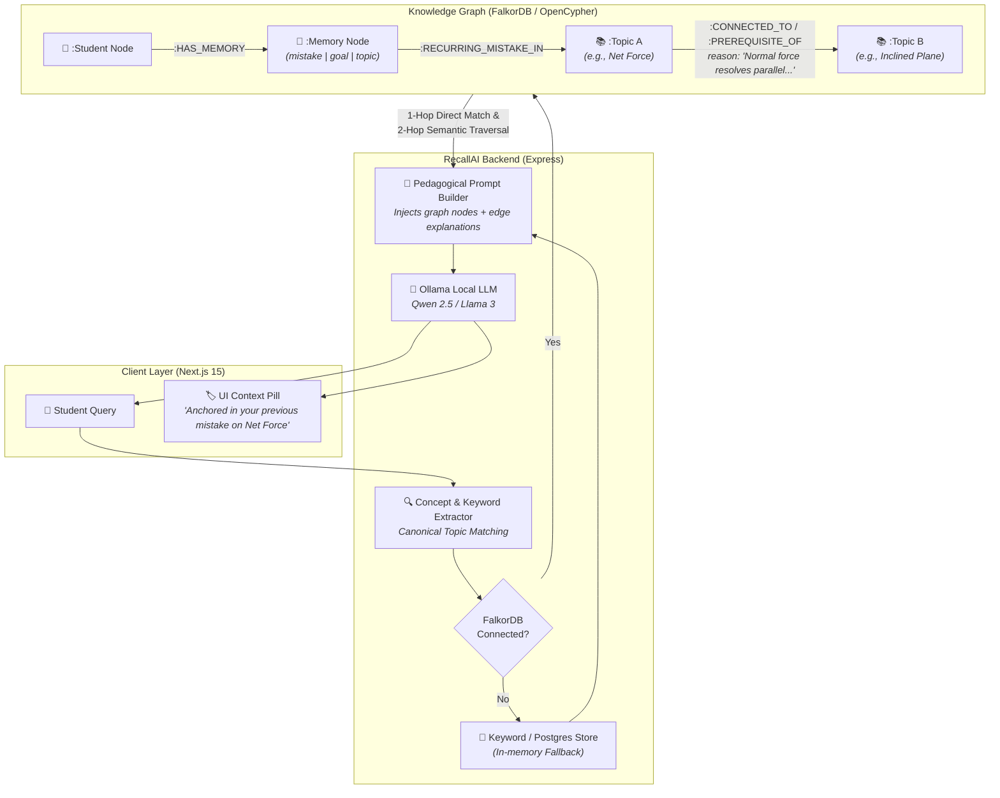
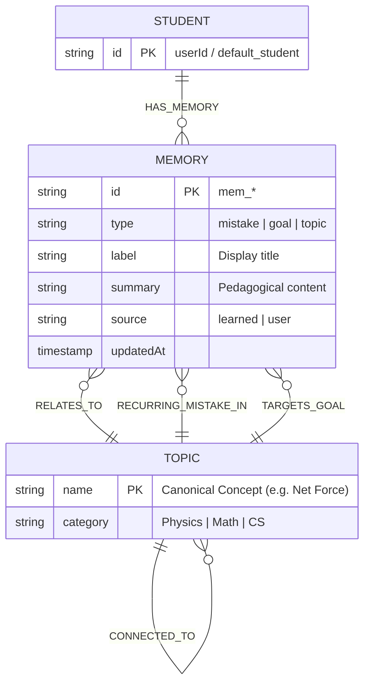
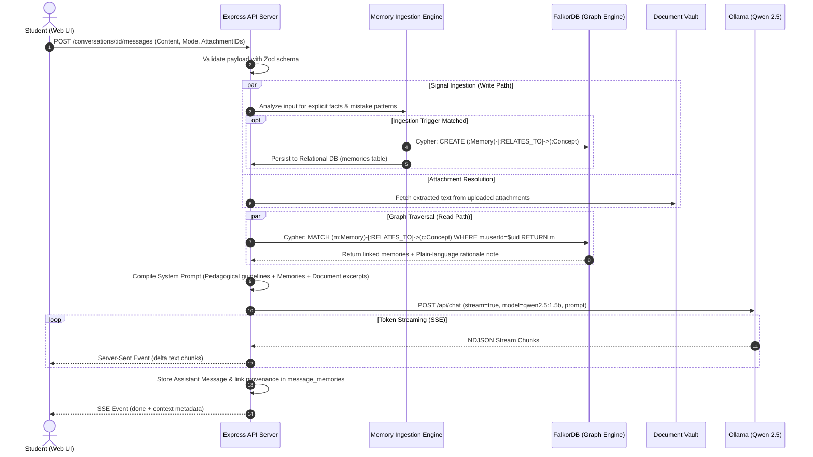

# 🧠 RecallAI — Architectural & Technical Setup Guide
> **Privacy-First, Graph-Augmented Academic Study Companion with Persistent Long-Term Memory (GraphRAG) and Local LLM Inference.**

[](https://nodejs.org/)
[](https://nextjs.org/)
[](https://react.dev/)
[](https://www.falkordb.com/)
[](https://ollama.com/)
[](https://www.typescriptlang.org/)

---

## ⚡ 1. Judge Quickstart

RecallAI is engineered with **zero-configuration resilient fallbacks**: it can run completely locally with zero external API keys or cloud dependencies.

### Step 1: Clone & Install Dependencies
```bash
git clone https://github.com/aman772136-maker/Recall-AI-prototype2.git
cd Recall-AI-prototype2
npm install
```

### Step 2: (Optional) Start Local LLM (Ollama)
If you want live on-device AI inference with Qwen 2.5:
```bash
ollama run qwen2.5:1.5b
```
*(Note: If Ollama is not installed or offline, RecallAI automatically activates its internal pedagogical provider without crashing!)*

### Step 3: Launch Frontend & Backend Concurrently
```bash
npm run dev
```
- **Web Application:** `http://localhost:3000`
- **API Server & Gateway:** `http://localhost:4000`

### Step 4: Verify Health
Open a terminal and verify all subsystems:
```bash
curl http://localhost:4000/health
```
**Expected Response:**
```json
{
  "status": "ok",
  "falkordb": true,
  "ollama": {
    "online": true,
    "hasModel": true,
    "model": "qwen2.5:1.5b"
  }
}
```

---

## 🎯 2. Quick Demo Script 

Test RecallAI’s core innovation — **cross-conversation memory continuity and graph-backed context**:

1. **Turn 1 (Log Identity & Recurring Weak Spot):**
   * Paste this into the chat composer:
     > *"My name is Aman. I am a BTech CSE student and I keep struggling with Eigenvalue calculations. Remember this."*
   * 👉 **Observe:** The right-hand **Study Context** panel immediately captures and surfaces the memory: `[MISTAKE] Recurring mistake: struggling with Eigenvalue calculations`.

2. **Turn 2 (Test Cross-Session Continuity in a New Conversation):**
   * Click **"+ New Chat"** (creates a completely blank conversation with a new ID).
   * Ask:
     > *"What should I practise next?"*
   * 👉 **Observe:** Qwen identifies your background and proactively recommends targeted exercises on **Eigenvalues and Linear Algebra** without you re-explaining anything.

3. **Turn 3 (Multi-Hop Academic Graph Reasoning & KaTeX Typesetting):**
   * Ask:
     > *"How does friction affect acceleration on an inclined plane?"*
   * 👉 **Observe:** The FalkorDB graph traverses dependencies between `Inclined Plane` $\rightarrow$ `Friction` $\rightarrow$ `Net Force` ($F_{net} = ma$), rendering formal KaTeX equations and highlighting common student traps.

---

## 🏛️ 3. High-Level System Architecture



---

## 🧠 4. Graph Memory Architecture & Knowledge Graph Schema

RecallAI couples a local LLM with an **OpenCypher knowledge graph** powered by [FalkorDB](https://www.falkordb.com/). Rather than treating memories as isolated vector embeddings, RecallAI represents learning history as an interconnected academic concept graph with directional dependencies and pedagogical metadata.



### Knowledge Graph Schema (Entities & Relationships)



### How Graph Retrieval Works (3-Stage Traversal)

When a student asks a question (e.g., *"How do I calculate acceleration down an inclined ramp?"*):

1. **Topic Extraction**:
   - The query is parsed against canonical concept dictionaries and tokenized keywords, identifying `Topic: Inclined Plane`.

2. **Multi-Hop OpenCypher Traversal**:
   - **Direct Matches (1-Hop)**:
     ```cypher
     MATCH (m:Memory)
     WHERE (m.userId = $userId OR m.userId IS NULL OR m.userId = '')
     OPTIONAL MATCH (m)-[r:RELATES_TO|TARGETS_GOAL|RECURRING_MISTAKE_IN]->(t:Topic)
     WHERE (size($keywords) > 0 AND any(kw IN $keywords WHERE toLower(m.summary) CONTAINS kw))
        OR (size($topics) > 0 AND t IS NOT NULL AND toLower(t.name) IN $topics)
     RETURN m, t
     ```
   - **Connected Concept Matches (2-Hop)**:
     Traverses concept prerequisites and connections (e.g., `Inclined Plane` $\rightarrow$ `Net Force`):
     ```cypher
     MATCH (m:Memory)-[r]->(t1:Topic)-[c:CONNECTED_TO|PREREQUISITE_OF]-(t2:Topic)
     WHERE toLower(t2.name) IN $topics AND NOT toLower(t1.name) IN $topics
     RETURN m.id, m.type, m.summary, t1.name, t2.name, c.reason
     ```

3. **Pedagogical Explanation & Synthesis**:
   - Edge metadata (`c.reason`) is automatically translated into natural language:
     > *"Connected your recurring mistake on Net Force: Inclined plane acceleration requires calculating net force along the axis parallel to the ramp."*
   - Injected directly into the Ollama system prompt to proactively address misconceptions before the student repeats them.

---

## 🔄 5. End-to-End Data Flow & Sequence Diagram



---

## 💡 6. Why RecallAI Wins: Technical Innovations

### 1. GraphRAG vs. Flat Vector Search
Traditional RAG systems rely on flat vector embeddings (cosine distance). They fail when navigating hierarchical academic concepts. 
* **RecallAI's Graph Advantage:** Uses **FalkorDB** and OpenCypher to map directional concept trees (e.g., `Determinants` $\xrightarrow{\text{PREREQUISITE\_OF}}$ `Eigenvalues` $\xrightarrow{\text{CONNECTED\_TO}}$ `Matrix Decompositions`). When a student fails a matrix decomposition problem, RecallAI diagnoses foundational gaps in determinants.

### 2. Zero Data Exfiltration (100% Privacy)
* Education and student progress data are highly sensitive. RecallAI runs **Qwen 2.5 locally via Ollama**. Notes, uploaded exam files, and student weaknesses are processed entirely on-device without telemetry or cloud SaaS dependencies.

### 3. Transparent Provenance & Explainability
* Black-box AI causes distrust. In RecallAI, every assistant response is linked to its exact source memories in `message_memories`. Students can click the **Study Context** button to see *why* an answer referenced a prior session.

### 4. Dynamic Pedagogical Personas
* **Study Mode (`study`)**: Intuitive mental model $\rightarrow$ Formal KaTeX mathematical equation $\rightarrow$ Common cognitive pitfall.
* **Deep-Dive Mode (`deep-dive`)**: Exhaustive derivations and non-trivial edge cases.
* **Quiz Mode (`quiz`)**: Exactly 3 diagnostic questions in ascending order of Bloom's Taxonomy.

---

## 🗄️ 7. Database Schema Design (PostgreSQL / Relational)

```sql
-- Conversations & Messages
CREATE TABLE conversations (
  id          UUID PRIMARY KEY DEFAULT gen_random_uuid(),
  title       TEXT NOT NULL DEFAULT 'New conversation',
  created_at  TIMESTAMPTZ NOT NULL DEFAULT now(),
  updated_at  TIMESTAMPTZ NOT NULL DEFAULT now()
);

CREATE TABLE messages (
  id              UUID PRIMARY KEY DEFAULT gen_random_uuid(),
  conversation_id UUID NOT NULL REFERENCES conversations(id) ON DELETE CASCADE,
  role            TEXT NOT NULL CHECK (role IN ('user', 'assistant', 'system')),
  content         TEXT NOT NULL DEFAULT '',
  status          TEXT NOT NULL DEFAULT 'complete',
  created_at      TIMESTAMPTZ NOT NULL DEFAULT now()
);

-- File Attachments & Extracted Multimodal Data
CREATE TABLE attachments (
  id              UUID PRIMARY KEY DEFAULT gen_random_uuid(),
  conversation_id UUID REFERENCES conversations(id) ON DELETE CASCADE,
  message_id      UUID REFERENCES messages(id) ON DELETE CASCADE,
  name            TEXT NOT NULL,
  mime_type       TEXT NOT NULL,
  size            BIGINT NOT NULL,
  kind            TEXT NOT NULL CHECK (kind IN ('document', 'image')),
  status          TEXT NOT NULL DEFAULT 'queued',
  extracted_text  TEXT,
  created_at      TIMESTAMPTZ NOT NULL DEFAULT now()
);

-- Long-Term Cognitive Memories
CREATE TABLE memories (
  id              UUID PRIMARY KEY DEFAULT gen_random_uuid(),
  conversation_id UUID REFERENCES conversations(id) ON DELETE CASCADE,
  message_id      UUID REFERENCES messages(id)     ON DELETE SET NULL,
  type            TEXT NOT NULL CHECK (type IN ('goal', 'topic', 'mistake', 'preference', 'study_session')),
  label           TEXT NOT NULL,
  summary         TEXT NOT NULL,
  source          TEXT NOT NULL DEFAULT 'learned' CHECK (source IN ('learned', 'suggested', 'demo')),
  keywords        TEXT[] NOT NULL DEFAULT '{}',
  updated_at      TIMESTAMPTZ NOT NULL DEFAULT now()
);
CREATE INDEX memories_keywords_idx ON memories USING GIN(keywords);

-- Full Provenance Audit Trail (Which memory influenced which message)
CREATE TABLE message_memories (
  message_id UUID NOT NULL REFERENCES messages(id) ON DELETE CASCADE,
  memory_id  UUID NOT NULL REFERENCES memories(id)  ON DELETE CASCADE,
  PRIMARY KEY (message_id, memory_id)
);
```

---

## ⚙️ 8. Environment Configuration Reference

Create `apps/api/.env` if customizing defaults:

| Variable | Default Value | Description |
| :--- | :--- | :--- |
| `PORT` | `4000` | Port for the Express API gateway |
| `OLLAMA_ENABLED` | `true` | Enables live local LLM streaming |
| `OLLAMA_BASE_URL` | `http://localhost:11434` | Ollama service endpoint |
| `OLLAMA_MODEL` | `qwen2.5:1.5b` | Target local model tag |
| `OLLAMA_TEMPERATURE` | `0.7` | Temperature for response generation |
| `FALKORDB_HOST` | `localhost` | FalkorDB graph server address |
| `FALKORDB_PORT` | `6379` | FalkorDB port (Redis protocol) |
| `FALKORDB_GRAPH` | `recallai_study_graph` | Name of the active study graph |
| `DATABASE_URL` | *(empty)* | Postgres URL (empty triggers in-memory fallback) |

---

## 🧪 9. Automated Testing & Verification

RecallAI features an automated end-to-end test suite testing graph extraction, multi-session memory recall, and live Qwen inference:

```bash
# Run end-to-end memory pipeline tests
npm run test:e2e --workspace=@recallai/api

# Run graph connection & Cypher tests
npm run test --workspace=@recallai/api
```

**Test Suite Verification Checklist:**
- [x] Memory extraction from natural language triggers
- [x] Cross-conversation recall with identical `userId`
- [x] Strict user isolation (User B cannot access User A's memories)
- [x] OpenCypher traversal over academic ontologies
- [x] Live Qwen streaming integration with KaTeX mathematical formatting
